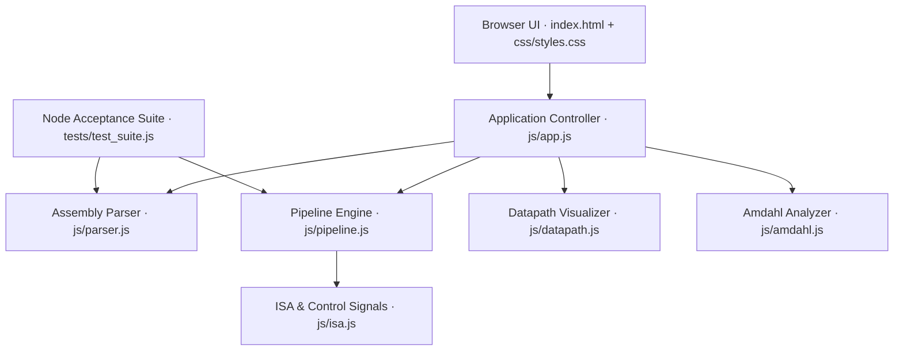

<div align="center">

# 🧠 Pipeline Lab

### Interactive 5-Stage RISC Pipeline & Datapath Studio

[](PASTE_YOUR_DEPLOYMENT_URL_HERE)
[](https://developer.mozilla.org/docs/Web/HTML)
[](https://developer.mozilla.org/docs/Web/JavaScript)
[](package.json)

<p><b>🔗 Live application:</b> <a href="https://pipeline-lab-wheat.vercel.app/#datapath-section">Add your deployment URL here</a></p>

*An interactive Computer Organization and Architecture project for visualizing instruction execution, pipeline hazards, datapath activity, and CPU performance.*

---

</div>

## 📌 Overview

Pipeline Lab makes the classic five-stage RISC pipeline easier to explore. Write or select an assembly program, run it through the simulator, and inspect the resulting cycle schedule, register state, memory, hazard events, and datapath activity.

The project focuses on the relationship between instruction overlap and performance: forwarding can reduce data stalls, shared resources can introduce structural conflicts, and taken branches affect the pipeline schedule.

### Highlights

- **Interactive pipeline timeline** with cycle-by-cycle stage occupancy, stalls, flushes, and cycle stepping.
- **Datapath hardware view** with stage cards, inter-stage latches, forwarding paths, and control signals.
- **Hazard event log** for RAW dependencies, load-use delays, structural hazards, forwarding, and control flow.
- **CPU state inspector** for 32 registers and data memory; view register values in decimal, hexadecimal, or binary.
- **Performance summary** with instruction count, cycles, CPI, throughput, stalls, flushes, and idealized speedup.
- **Amdahl’s Law analyzer** with a live speedup calculation and interactive curve.
- **Markdown and CSV export** for simulation results.
- **Dark and light themes**, example programs, cycle scrubbing, single-step controls, and auto-play.

---

## ⚡ Quick Start

### Run in a browser

Open `index.html` in a modern browser. The app is a static front end with no build step or third-party JavaScript packages.

### Run with the local server

Python is required for the built-in server. From the project directory, run:

```bash
npm start
```

Then visit **http://localhost:5500**.

To run the acceptance tests, install Node.js and use:

```bash
npm test
```

> Google Fonts are loaded when a network connection is available. The app falls back to system fonts when offline.

---

## 🧪 Try the Simulator

1. Choose an example such as **2. RAW Data Hazard & Forwarding**.
2. Click **Run Simulation** or press **Ctrl + Enter**.
3. Compare the schedule with forwarding enabled and disabled.
4. Use **Step Next**, **Prev**, **Auto Play**, or the cycle slider to inspect a cycle.
5. Open the **Datapath**, **Hazard Event Log**, and **Data Memory Map** tabs.
6. Export the run as Markdown or CSV from the timeline view.

### Example program

```asm
ADD  R1, R2, R3       # R1 = 100 + 10
SUB  R4, R1, R5       # RAW dependency on R1
LW   R6, 0(R2)        # Load from MEM[100]
BEQ  R1, R4, TARGET   # Branch if equal
ADDI R7, R0, 99       # Runs only if the branch is not taken
TARGET: SW R6, 4(R2)  # Store to MEM[104]
```

---

## 🔬 Pipeline Concepts

The model uses five stages separated by pipeline registers:


| Concept | What the simulator demonstrates |
|---|---|
| **Data hazard (RAW)** | A consumer needs a register produced by an earlier instruction. Forwarding can bypass a result to EX; disabling forwarding inserts waits. |
| **Load-use hazard** | A loaded value is not ready as early as an ALU result, so the dependent instruction may need a stall even with forwarding. |
| **Structural hazard** | Shared-memory mode can make instruction fetch contend with a load or store. |
| **Control hazard** | A taken branch resolves in EX and incurs the model’s branch penalty, with younger speculative instructions flushed. |

---

## 🧩 Instruction Set

| Category | Instructions | Example syntax |
|---|---|---|
| Arithmetic | `ADD`, `SUB`, `MUL` | `ADD Rd, Rs, Rt` |
| Immediate arithmetic | `ADDI`, `SUBI` | `ADDI Rd, Rs, immediate` |
| Bitwise logic | `AND`, `OR`, `XOR`, `NOR` | `AND Rd, Rs, Rt` |
| Comparisons | `SLT`, `SLTI` | `SLT Rd, Rs, Rt` |
| Memory | `LW`, `SW` | `LW Rt, offset(Rs)` |
| Branches | `BEQ`, `BNE` | `BEQ Rs, Rt, LABEL` |
| Jumps | `J`, `JR` | `J LABEL` / `JR Rs` |
| No operation | `NOP` | `NOP` |

The parser supports labels, comments beginning with `#`, decimal and hexadecimal immediates, and one- or two-operand arithmetic shorthand. Registers are `R0`–`R31`; `R0` is fixed at zero. Memory uses word-indexed addresses in this educational model.

### Default processor state

Every run starts with the same values:

- **Registers:** `R2=100`, `R3=10`, `R4=3`, `R5=1`, `R6=6`, `R7=2`, `R8=8`, `R9=4`; all others are zero.
- **Memory:** `MEM[100]=7`, `MEM[104]=11`, `MEM[108]=15`, `MEM[112]=24`, `MEM[116]=42`.

---

## 📊 Performance Metrics

| Metric | Calculation |
|---|---|
| **CPI** | Total cycles ÷ completed instructions |
| **Throughput (IPC)** | Completed instructions ÷ total cycles |
| **Idealized speedup** | (5 × instruction count) ÷ pipelined cycles |
| **Amdahl’s Law** | `1 / ((1 − P) + P / S)` |

The speedup compares the modeled pipeline with an ideal serial baseline of five equal stage-times per instruction. It is a teaching estimate, not a hardware benchmark.

---

## 🏗️ Architecture & Tech Stack



The application uses plain HTML, CSS, and JavaScript. There is no frontend framework or JavaScript package dependency. The development server uses Python’s standard library, while the automated checks run on Node.js.

---

## 📂 Project Structure

```text
COA_Micro_Project/
├── index.html                 # Main interface and learning guide
├── package.json               # Local server and test commands
├── simulator.js               # Node compatibility exports
├── css/
│   └── styles.css             # Responsive UI and themes
├── js/
│   ├── isa.js                 # Instruction definitions and control signals
│   ├── parser.js              # Assembly parsing and label resolution
│   ├── pipeline.js            # Execution, cycle timing, and hazard model
│   ├── datapath.js            # Hardware/datapath visualization
│   ├── amdahl.js               # Speedup calculator and chart
│   └── app.js                 # UI, playback, and export handling
├── tests/
│   └── test_suite.js          # Automated acceptance checks
└── docs/
    ├── DEMO.md                # Presentation and viva walkthrough
    ├── REPORT.md              # Project report
    ├── TEST_CASES.md          # Verification matrix
    └── COA_Micro_Project.code-workspace
```

---

## ✅ Verification

Run the included acceptance suite from the project root:

```bash
npm test
```

The suite covers arithmetic, registers, memory, forwarding, stalls, branches, and selected bitwise operations. The expected scenarios are documented in [`docs/TEST_CASES.md`](docs/TEST_CASES.md).

---

## 🚀 Deployment

Pipeline Lab is a static website. Publish the project directory with its relative paths intact: `index.html`, `css/`, and `js/` must remain together. GitHub Pages and other static hosting providers can serve the app; the local Python server is for development.

When deployment is complete, replace `PASTE_YOUR_DEPLOYMENT_URL_HERE` in the badge and live-application link at the top of this file.

---

## 📚 Project Documents

- [Project report](docs/REPORT.md)
- [Presentation and viva walkthrough](docs/DEMO.md)
- [Acceptance test matrix](docs/TEST_CASES.md)

## 📖 References

1. David A. Patterson and John L. Hennessy, *Computer Organization and Design: The Hardware/Software Interface*, Morgan Kaufmann.
2. M. Morris Mano, *Computer System Architecture*, Pearson.
3. John L. Hennessy and David A. Patterson, *Computer Architecture: A Quantitative Approach*, Morgan Kaufmann.

<div align="center">

*Built as a COA micro-project to make pipeline execution and performance easier to explore.*

</div>

